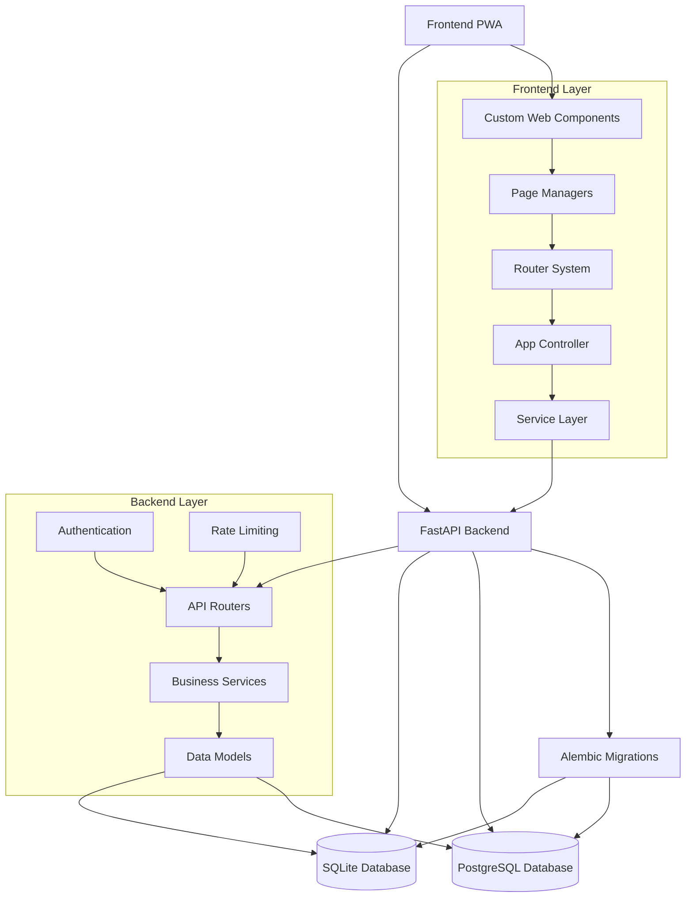
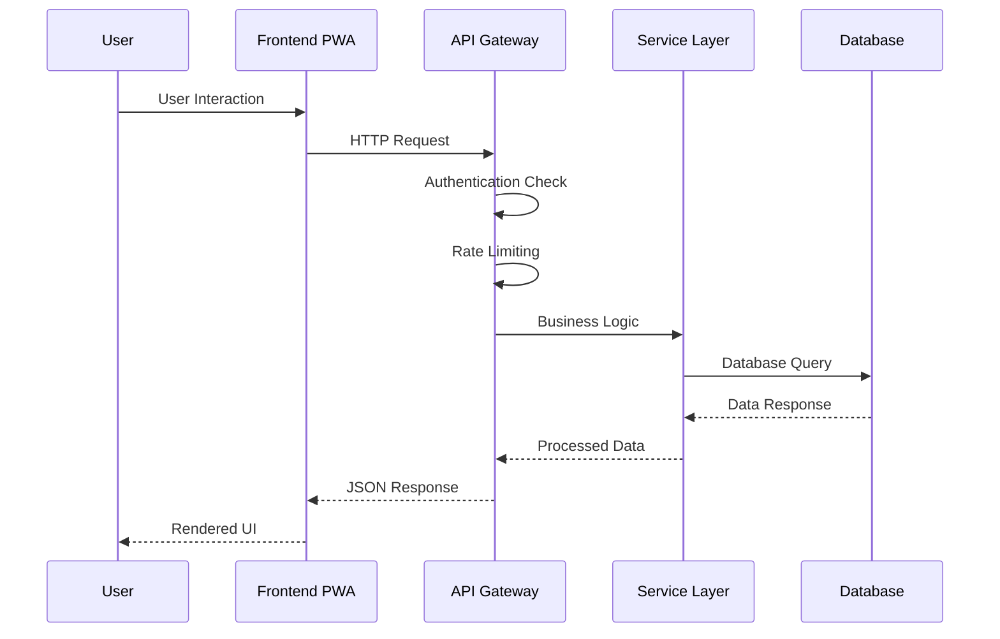
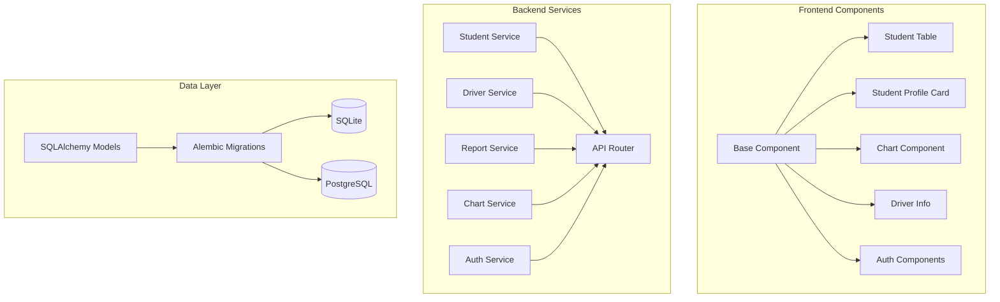

# Architecture Overview

For comprehensive architecture documentation including system design, data flow diagrams, and technical specifications, please see our [Architecture Guide](../development/architecture.md).

## System Architecture



## Data Flow Architecture



## Component Architecture



## Backend Architecture

### Router/Service Pattern

The backend follows a modular architecture with clear separation of concerns:

- **API Routers** (`backend/routers/`): Handle HTTP requests and responses
- **Business Services** (`backend/services/`): Contain core business logic
- **Data Models** (`backend/models.py`): Define data structures and validation
- **Database Layer**: SQLAlchemy ORM with async support

### Key Components

#### API Routers
- **students.py**: Student CRUD operations and search functionality
- **drivers.py**: Driver management and route assignments
- **reports.py**: Analytics and reporting endpoints
- **charts.py**: Data visualization endpoints

#### Business Services
- **student_service.py**: Student-related business logic
- **driver_service.py**: Driver and route management logic
- **report_service.py**: Analytics and reporting calculations
- **chart_service.py**: Chart data preparation and formatting

#### Data Models
- **Pydantic Models**: Request/response validation and serialization
- **SQLAlchemy Models**: Database schema and relationships
- **Alembic Migrations**: Version-controlled database schema evolution

## Frontend Architecture

### Component-Based Architecture

The frontend uses modern web components with Shadow DOM encapsulation:

#### Core Components
- **Base Component**: Foundation class for all custom elements
- **Student Table**: Displays student data with sorting and filtering
- **Student Profile Card**: Individual student information display
- **Chart Component**: Interactive data visualizations
- **Driver Info**: Driver statistics and route information
- **Auth Components**: Login, registration, and user management

#### Page Managers
- **Dashboard Manager**: Main dashboard logic and state management
- **Students Manager**: Student management page functionality
- **Transport Manager**: Driver and route management
- **Reports Manager**: Analytics and reporting interface

#### Application Controller
- **Router**: Client-side navigation and URL management
- **App Controller**: Central state management and coordination
- **Service Layer**: API communication and data management

### State Management

The application uses a centralized state management approach:

```typescript
// Global application state
interface AppState {
  currentUser: User | null;
  currentPage: string;
  students: Student[];
  drivers: Driver[];
  loading: boolean;
  error: string | null;
}

// Reactive state updates
class AppController {
  private state: AppState;
  private subscribers: Set<(state: AppState) => void>;

  updateState(newState: Partial<AppState>) {
    this.state = { ...this.state, ...newState };
    this.notifySubscribers();
  }
}
```

### Service Worker Architecture

Progressive Web App capabilities with offline functionality:

```javascript
// Service worker for caching and offline support
const CACHE_NAME = 'student-profiles-v1';
const STATIC_CACHE = 'static-v1';
const DYNAMIC_CACHE = 'dynamic-v1';

// Cache strategies for different resource types
const CACHE_STRATEGIES = {
  cacheFirst: async (request) => {
    const cached = await caches.match(request);
    if (cached) return cached;
    // Fetch and cache for future use
  },

  networkFirst: async (request) => {
    try {
      const response = await fetch(request);
      // Cache successful responses
      return response;
    } catch (error) {
      // Return cached version as fallback
      return caches.match(request);
    }
  }
};
```

## Database Architecture

### Dual Database Support

The application supports both SQLite and PostgreSQL databases:

#### SQLite (Development)
- **File-based database**: `backend/data/students.db`
- **Zero configuration**: No additional setup required
- **Development optimized**: Fast startup and simple deployment

#### PostgreSQL (Production)
- **Production-grade database**: Full ACID compliance
- **Connection pooling**: Optimized for concurrent connections
- **Advanced features**: JSON support, full-text search, analytics

### Migration Strategy

Alembic handles database schema evolution:

```bash
# Create new migration
alembic revision --autogenerate -m "Add student phone field"

# Apply migrations
alembic upgrade head

# Rollback if needed
alembic downgrade -1
```

### Data Relationships

The database schema includes these key relationships:

- **Students ↔ Drivers**: Many-to-one relationship via route assignments
- **Users ↔ Roles**: Role-based access control system
- **Students ↔ Classes**: Academic grouping and organization
- **Routes ↔ Areas**: Geographic organization for transportation

## Integration Architecture

### API Integration

RESTful API design with consistent patterns:

```typescript
// Frontend API service
class ApiService {
  async getStudents(filters: StudentFilters): Promise<StudentList> {
    const response = await fetch(`/api/students?${new URLSearchParams(filters)}`, {
      credentials: 'include', // Include authentication cookies
      headers: {
        'Content-Type': 'application/json',
      }
    });

    if (!response.ok) {
      throw new ApiError(response.status, await response.text());
    }

    return response.json();
  }
}
```

### Authentication Integration

JWT-based authentication with automatic token management:

```typescript
// Authentication flow
class AuthService {
  async login(credentials: LoginCredentials): Promise<User> {
    const response = await fetch('/auth/login', {
      method: 'POST',
      body: JSON.stringify(credentials),
      credentials: 'include'
    });

    if (response.ok) {
      // Tokens stored in HttpOnly cookies automatically
      const user = await response.json();
      this.updateAuthState(user);
      return user;
    }

    throw new AuthenticationError('Invalid credentials');
  }
}
```

### Real-time Updates

Event-driven architecture for live data synchronization:

```typescript
// WebSocket integration for real-time updates
class RealtimeService {
  private socket: WebSocket | null = null;

  connect() {
    this.socket = new WebSocket('ws://localhost:8000/ws/updates');

    this.socket.onmessage = (event) => {
      const update = JSON.parse(event.data);
      this.handleUpdate(update);
    };
  }

  private handleUpdate(update: DataUpdate) {
    switch (update.type) {
      case 'student_created':
        this.addStudentToList(update.data);
        break;
      case 'student_updated':
        this.updateStudentInList(update.data);
        break;
      case 'student_deleted':
        this.removeStudentFromList(update.data.id);
        break;
    }
  }
}
```

## Security Architecture

### Authentication & Authorization

Multi-layered security approach:

- **JWT Authentication**: Industry-standard token-based authentication
- **Role-Based Access Control**: Hierarchical permission system
- **Rate Limiting**: API abuse prevention
- **CORS Protection**: Cross-origin request security
- **Input Validation**: Comprehensive data sanitization

### Data Protection

- **Encryption at Rest**: Sensitive data encrypted in database
- **Secure Transmission**: HTTPS/TLS for all communications
- **Session Management**: Secure cookie-based sessions
- **Audit Logging**: Comprehensive security event tracking

## Performance Architecture

### Caching Strategy

Multi-level caching for optimal performance:

- **Database Query Caching**: Expensive queries cached with TTL
- **API Response Caching**: Frequently accessed data cached
- **Frontend Caching**: Service worker caching for offline support
- **CDN Integration**: Static assets served via CDN in production

### Scalability Considerations

Horizontal scaling support:

- **Stateless Backend**: Easy horizontal scaling
- **Database Read Replicas**: Read scaling for analytics
- **Load Balancing**: Traffic distribution across instances
- **Microservices Ready**: Modular architecture supports decomposition

This architecture provides a solid foundation for a scalable, maintainable, and secure school management application with excellent user experience and development productivity.