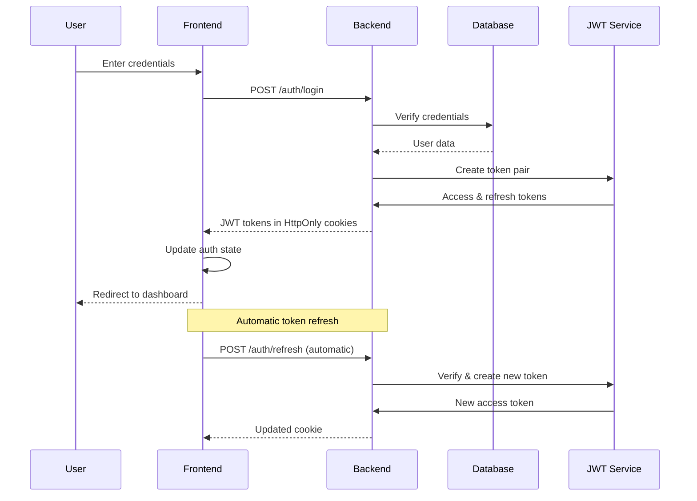
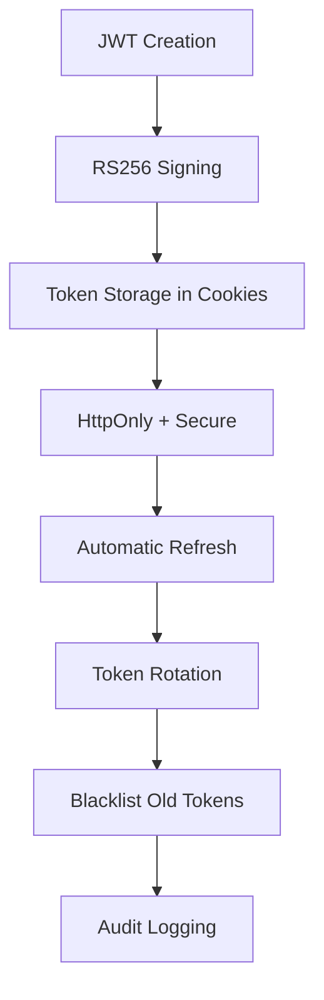

# Authentication System Documentation

## Overview

The Student Profiles PWA implements a comprehensive JWT-based authentication system with secure cookie handling, role-based access control, and robust security features. This system provides secure user authentication for students, teachers, drivers, and administrators.

## Architecture

### Authentication Flow



### System Components

#### **Core Authentication Services**

- **Frontend Auth Components**: Login form, auth context, user session management, token refresh logic
- **Backend Auth Router**: JWT token management, user validation, secure endpoints with role-based access
- **JWT Service**: Enhanced token management with RS256 signing, blacklisting, and audit logging
- **Database Models**: User accounts with role-based permissions and guest user support
- **Security Middleware**: Rate limiting, CORS configuration, input validation, audit logging
- **Configuration System**: Environment-based configuration with validation and security defaults

#### **Security Infrastructure**

- **Token Management**: Dual token system with automatic rotation and blacklisting
- **Password Security**: bcrypt hashing with salt generation and validation
- **Session Management**: HttpOnly cookies with configurable security attributes
- **Rate Limiting**: Configurable request limits with exponential backoff support
- **Audit System**: Comprehensive logging of authentication events and security incidents

### **Technical Architecture Overview**

#### **Backend Architecture**

```python
# Core authentication modules
backend/
├── src/
│   ├── api/v1/routers/
│   │   └── auth.py           # Authentication endpoints
│   ├── utils/
│   │   └── auth_utils.py     # Core auth utilities and middleware
│   ├── services/
│   │   └── jwt_service.py    # Enhanced JWT service with security features
│   ├── core/
│   │   ├── config/
│   │   │   └── config.py     # Configuration management
│   │   └── models/
│   │       └── models.py     # Database models and Pydantic schemas
│   └── middleware/
│       └── security.py       # Security middleware and rate limiting
```

#### **Frontend Architecture**

```typescript
// Authentication structure
frontend/src/ts/
├── components/auth/
│   ├── auth-context.ts       # Global auth state management
│   ├── login-component.ts    # Login form component
│   ├── logout-component.ts   # Logout functionality
│   ├── register-component.ts # User registration (admin)
│   ├── profile-component.ts  # User profile management
│   └── guest-dashboard-component.ts # Guest user features
├── services/
│   └── auth-service.ts       # Frontend auth service layer
├── utils/
│   └── error-handler.ts      # Authentication error handling
└── page-managers/
    └── dashboard-manager.ts  # Auth-aware page management
```

### **Critical Issues Identified**

#### **1. JWT Exception Handling Bug**

**Location**: [`backend/src/utils/auth_utils.py`](backend/src/utils/auth_utils.py:167-206)

**Issue**: The `verify_token` function raises HTTPException for expired/invalid tokens instead of returning None, causing issues in calling code.

**Problem Code**:
```python
def verify_token(token: str, token_type: str = "access") -> Optional[dict]:
    try:
        payload = jwt.decode(token, SECRET_KEY, algorithms=[ALGORITHM])
        if payload.get("type") != token_type:
            return None
        return payload
    except jwt.ExpiredSignatureError:
        # ❌ PROBLEM: Raising exception instead of returning None
        raise HTTPException(
            status_code=status.HTTP_401_UNAUTHORIZED,
            detail="Token has expired",
            headers={"WWW-Authenticate": "Bearer"},
        )
    except jwt.InvalidTokenError:
        # ❌ PROBLEM: Raising exception instead of returning None
        raise HTTPException(
            status_code=status.HTTP_401_UNAUTHORIZED,
            detail="Invalid token",
            headers={"WWW-Authenticate": "Bearer"},
        )
```

**Impact**:
- Authentication middleware failures when tokens expire
- Poor error handling in `get_current_user` function
- Inconsistent error responses across the application

**Recommended Solution**:
```python
def verify_token(token: str, token_type: str = "access") -> Optional[dict]:
    try:
        payload = jwt.decode(token, SECRET_KEY, algorithms=[ALGORITHM])
        if payload.get("type") != token_type:
            return None
        return payload
    except (jwt.ExpiredSignatureError, jwt.InvalidTokenError):
        # ✅ BETTER: Return None and let calling code handle exceptions
        return None
    except Exception as e:
        # Log unexpected errors but don't expose details
        logger.warning(f"Token verification error: {e}")
        return None
```

#### **2. JWT Service Configuration Attribute Error**

**Location**: [`backend/src/services/jwt_service.py`](backend/src/services/jwt_service.py:34, 297)

**Issue**: Import issues with configuration module causing runtime errors.

**Problem Code**:
```python
# ❌ PROBLEM: Incorrect import path
from ..core.config import config

def _get_token_expiry(self, token_type: TokenType) -> datetime:
    now = datetime.now(timezone.utc)
    if token_type == TokenType.ACCESS:
        # ❌ PROBLEM: config may not have these attributes
        return now + timedelta(minutes=config.ACCESS_TOKEN_EXPIRE_MINUTES)
    else:
        return now + timedelta(days=config.REFRESH_TOKEN_EXPIRE_DAYS)
```

**Impact**:
- JWT service initialization failures
- Token creation errors
- Runtime crashes during authentication

**Recommended Solution**:
```python
# ✅ BETTER: Correct import path
from ..core.config.config import config

def _get_token_expiry(self, token_type: TokenType) -> datetime:
    now = datetime.now(timezone.utc)
    if token_type == TokenType.ACCESS:
        minutes = getattr(config, 'ACCESS_TOKEN_EXPIRE_MINUTES', 15)
        return now + timedelta(minutes=minutes)
    else:
        days = getattr(config, 'REFRESH_TOKEN_EXPIRE_DAYS', 7)
        return now + timedelta(days=days)
```

### **Security Architecture**

#### **Multi-Layer Security Implementation**

1. **Transport Security**
   - HTTPS/TLS encryption for all communications
   - Secure cookie attributes in production
   - HSTS headers for HTTP strict transport security

2. **Authentication Security**
   - JWT with configurable expiration times
   - HttpOnly cookies preventing XSS attacks
   - SameSite cookie attributes for CSRF protection
   - Token blacklisting for logout functionality

3. **Authorization Security**
   - Role-based access control (RBAC) with hierarchy
   - Endpoint-specific permission checking
   - Admin-only operations with proper validation
   - Guest user isolation and limitations

4. **Input Security**
   - Comprehensive input validation using Pydantic
   - SQL injection prevention via parameterized queries
   - XSS protection through content sanitization
   - File upload security with type validation

#### **Token Security Architecture**



**Token Lifecycle**:
1. **Creation**: RS256 signed tokens with unique JTI and expiration
2. **Storage**: HttpOnly cookies with appropriate security attributes
3. **Usage**: Automatic inclusion in API requests via browser
4. **Refresh**: Proactive refresh before expiration (5 minutes early)
5. **Rotation**: New token generation with old token blacklisting
6. **Revocation**: Complete session cleanup on logout

## Security Features

### JWT Token Management

#### **Dual Token Architecture**

**Access Tokens**
- **Expiration**: 15 minutes (configurable via `ACCESS_TOKEN_EXPIRE_MINUTES`)
- **Algorithm**: HS256 with 256-bit secret key
- **Usage**: API authentication for individual requests
- **Storage**: HttpOnly cookies (client-side inaccessible to JavaScript)
- **Security**: Automatic blacklisting on logout

**Refresh Tokens**
- **Expiration**: 7 days (configurable via `REFRESH_TOKEN_EXPIRE_DAYS`)
- **Algorithm**: HS256 with same secret key
- **Usage**: Generate new access tokens when expired
- **Storage**: HttpOnly cookies with extended expiration
- **Security**: Single-use rotation for enhanced security

#### **Enhanced JWT Service Features**

The system includes an advanced JWT service ([`jwt_service.py`](backend/src/services/jwt_service.py)) with enterprise-grade security:

- **RS256 Signing**: Military-grade RSA signature algorithm (2048-bit keys)
- **Token Blacklisting**: Immediate revocation capability with database persistence
- **Device Fingerprinting**: SHA-256 based device identification for session tracking
- **Audit Logging**: Comprehensive authentication event logging for security monitoring
- **Rate Limiting**: Brute force protection with configurable attempt limits (5 attempts, 15-minute lockout)
- **Token Rotation**: Automatic token refresh with old token blacklisting

#### **Cookie Security Configuration**

```python
# Production cookie settings
response.set_cookie(
    key="access_token",
    value=access_token,
    httponly=True,        # Prevents XSS attacks
    secure=True,         # HTTPS only in production
    samesite="strict",   # Maximum CSRF protection
    max_age=15 * 60,     # 15 minutes
    path="/",
    domain=production_domain  # Specific domain in production
)

# Development cookie settings (more permissive for local development)
response.set_cookie(
    key="access_token",
    value=access_token,
    httponly=True,
    secure=False,        # Allow HTTP in development
    samesite="lax",      # Balanced security
    max_age=15 * 60
)
```

### **Security Assessment Results**

#### **Authentication Security**

✅ **STRENGTHS**
- **Enterprise-grade JWT implementation** with proper secret management
- **Secure token storage** using HttpOnly cookies preventing XSS attacks
- **Comprehensive rate limiting** protecting against brute force attacks
- **Role-based access control** with proper hierarchy and validation
- **Audit logging** for security monitoring and compliance
- **Input validation** using Pydantic models with comprehensive error handling

🔧 **AREAS NEEDING IMPROVEMENT**
- **JWT exception handling** needs refinement (see Critical Issues section)
- **Configuration import** paths need verification and hardening
- **Password strength requirements** could be enhanced with complexity rules
- **Session management** could benefit from concurrent session limits

#### **Data Protection**

✅ **IMPLEMENTED**
- **Password hashing** with bcrypt and automatic salt generation
- **SQL injection prevention** through parameterized queries
- **CORS protection** with configurable origins
- **Input sanitization** for file uploads and user content
- **Secure headers** implementation for XSS and clickjacking protection

#### **Network Security**

✅ **CONFIGURED**
- **HTTPS support** with SSL certificate configuration
- **Security headers** (X-Frame-Options, X-Content-Type-Options, etc.)
- **Rate limiting** middleware with configurable limits
- **CORS middleware** with environment-specific origins

### **Advanced Security Features**

#### **Device Fingerprinting**

```python
class DeviceFingerprint:
    @staticmethod
    def generate(user_agent: str, ip_address: str, accept_language: str = "") -> str:
        """Generate device fingerprint from request data."""
        fingerprint_data = f"{user_agent}|{ip_address}|{accept_language}"
        return hashlib.sha256(fingerprint_data.encode()).hexdigest()
```

**Security Benefits**:
- Multi-device session tracking
- Suspicious login detection
- Session hijacking prevention
- Enhanced audit trails

#### **Token Blacklisting System**

```python
class TokenBlacklistManager:
    async def blacklist_token(self, db: AsyncSession, jti: str, token_type: TokenType,
                             expires_at: datetime, reason: str = "logout") -> None:
        """Add token to blacklist with database persistence."""
        # In-memory cache for performance
        self._memory_blacklist.add(jti)

        # Database storage for persistence across restarts
        blacklist_entry = TokenBlacklist(
            jti=jti,
            token_type=token_type.value,
            expires_at=expires_at,
            reason=reason,
            created_at=datetime.now(timezone.utc)
        )
        db.add(blacklist_entry)
        await db.commit()
```

#### **Comprehensive Audit Logging**

```python
class AuditLogger:
    @staticmethod
    async def log_login(db: AsyncSession, username: str, device_id: str,
                        ip_address: str, success: bool, reason: str = None) -> None:
        """Log all login attempts for security monitoring."""
        audit_entry = AuthAuditLog(
            username=username,
            action="login",
            device_id=device_id,
            ip_address=ip_address,
            success=success,
            reason=reason,
            created_at=datetime.now(timezone.utc)
        )
        db.add(audit_entry)
        await db.commit()
```

**Logged Events**:
- Login attempts (successful and failed)
- Token refresh operations
- Logout events
- Password changes
- Role modifications
- Guest user conversions

### Cookie Security

```javascript
// Login response sets secure cookies
response.set_cookie(
    key="access_token",
    value=access_token,
    httponly=True,        // Prevents XSS attacks
    max_age=15 * 60,     // 15 minutes
    path="/",
    secure=False,        // Set to True in HTTPS production
    samesite="lax"       // CSRF protection
)
```

### Password Security

- **Hashing Algorithm**: bcrypt with salt rounds
- **Storage**: Only hashed passwords stored in database
- **Validation**: Server-side password verification

## User Roles and Permissions

### Role Hierarchy

| Role | Level | Permissions |
|------|-------|-------------|
| **admin** | 1 | Full system access, user management |
| **teacher** | 2 | Student data, reports, limited admin functions |
| **driver** | 3 | Route information, student assignments |
| **student** | 4 | Personal profile, basic information access |

### Role-Based Access Control

```python
# Backend endpoint protection
@router.post("/register", response_model=User)
async def register_user(
    user_data: CreateUserRequest,
    db: AsyncSession = Depends(get_db),
    current_user: User = Depends(require_admin)  # Admin only
) -> User:
```

## Frontend Implementation

### Auth Context (`auth-context.ts`)

The authentication context provides centralized state management:

```typescript
interface AuthContextValue {
    state: AuthState;
    login: (credentials) => Promise<void>;
    logout: () => Promise<void>;
    refreshAuth: () => Promise<void>;
    clearError: () => void;
}
```

### Login Component

**Features:**
- Form validation and error handling
- Loading states with visual feedback
- Secure credential submission
- Responsive design with accessibility features

**Security Measures:**
- Input sanitization and validation
- CSRF protection via cookie configuration
- Secure error message handling
- Automatic form reset after failed attempts

### Session Management

```typescript
// Automatic token refresh
async refreshAuth(): Promise<void> {
    try {
        const { authService } = await import('../../services/auth-service');
        const refreshResult = await authService.refreshToken();

        if (!refreshResult.success) {
            // Redirect to login if refresh fails
            this.setState({
                user: null,
                isAuthenticated: false,
                isLoading: false
            });
        }
    } catch (error) {
        // Handle refresh errors gracefully
        console.error('Auth refresh error:', error);
    }
}
```

## Backend Implementation

### Authentication Router (`auth.py`)

#### Login Endpoint
```python
@router.post("/login", response_model=TokenResponse)
async def login(
    request: LoginRequest,
    response: Response,
    db: AsyncSession = Depends(get_db)
) -> TokenResponse:
    # Validate credentials
    # Create JWT tokens
    # Set HttpOnly cookies
    # Return user data
```

#### Token Refresh
```python
@router.post("/refresh", response_model=TokenResponse)
async def refresh_token(
    refresh_token: str = None,
    db: AsyncSession = Depends(get_db)
) -> TokenResponse:
    # Validate refresh token
    # Generate new access token
    # Maintain user session
```

### Security Middleware

#### Rate Limiting (SlowAPI)
- **Default Limits**: 30-60 requests per minute
- **Configurable**: Environment-based rate configuration
- **Protection**: Prevents brute force attacks

#### CORS Configuration
```python
# Dynamic CORS based on frontend port
origins = [
    f"http://127.0.0.1:{FRONTEND_PORT}",
    f"http://localhost:{FRONTEND_PORT}",
    "http://127.0.0.1:5173",  # Default PWA port
    "http://localhost:5173"
]
```

## Database Schema

### User Model

```python
class DBUser(Base):
    __tablename__ = "users"

    id = Column(Integer, primary_key=True, index=True)
    username = Column(String, unique=True, index=True)
    email = Column(String, unique=True, index=True)
    hashed_password = Column(String)
    role = Column(String, default="student")
    is_active = Column(Boolean, default=True)
    created_at = Column(DateTime, default=datetime.utcnow)
    updated_at = Column(DateTime, default=datetime.utcnow, onupdate=datetime.utcnow)
```

## API Endpoints

### Authentication Endpoints

| Method | Endpoint | Description | Authentication |
|--------|----------|-------------|----------------|
| POST | `/auth/login` | User login with credentials | None |
| POST | `/auth/logout` | Clear cookies and logout | Required |
| POST | `/auth/refresh` | Refresh access token | None* |
| GET | `/auth/me` | Get current user info | Required |
| POST | `/auth/register` | Create new user account | Admin only |
| **POST** | **`/auth/bypass-login`** | **Bypass login for development** | **Configuration required** |

*Requires valid refresh token in cookies

#### **POST /auth/bypass-login** (Development/Testing Only)

🚨 **SECURITY WARNING**: This endpoint is for development and testing only and must be disabled in production.

**Request:**
```json
{
  "username": "bypass_user"
}
```

**Response (Success):**
```json
{
  "access_token": "eyJ0eXAiOiJKV1QiLCJhbGciOiJIUzI1NiJ9...",
  "user": {
    "id": "bypass_user",
    "username": "bypass_user",
    "email": "bypass_user@bypass.local",
    "role": "admin",
    "is_active": true,
    "is_bypass_user": true
  }
}
```

**Response (Error - Disabled):**
```json
{
  "detail": "Login bypass is disabled"
}
```

**Configuration Required:**
- `LOGIN_BYPASS_ENABLED=true` (backend)
- `VITE_ENABLE_LOGIN_BYPASS=true` (frontend)

For detailed documentation, see **[Login Bypass Guide](login-bypass/overview.md)**.

### Request/Response Examples

#### Login Request
```json
{
  "username_or_email": "admin",
  "password": "secure_password"
}
```

#### Login Response
```json
{
  "access_token": "eyJ0eXAiOiJKV1QiLCJhbGciOiJIUzI1NiJ9...",
  "user": {
    "id": 1,
    "username": "admin",
    "email": "admin@example.com",
    "role": "admin",
    "is_active": true,
    "created_at": "2025-01-01T00:00:00Z"
  }
}
```

## Error Handling

### Authentication Errors

| Error Code | Description | Common Causes |
|------------|-------------|---------------|
| 401 | Unauthorized | Invalid credentials, expired token |
| 400 | Bad Request | Inactive user, malformed request |
| 429 | Too Many Requests | Rate limit exceeded |

### Frontend Error Handling

```typescript
// Graceful error handling in auth context
try {
    await authContext.login(credentials);
} catch (error) {
    // Display user-friendly error message
    this.showError(error.message || 'Login failed');

    // Clear sensitive data
    this.reset();
}
```

## Development User Integration

### Login Bypass Feature (Development/Testing)

The system includes a **login bypass feature** that allows developers to quickly access the application without credentials. This feature is designed exclusively for development and testing environments.

#### **🚨 CRITICAL SECURITY WARNING**
- **DEVELOPMENT/TESTING ONLY**: Must be disabled in production
- **Administrative Access**: Bypasses password authentication entirely
- **Security Logging**: All bypass activities are logged for audit
- **Clear Identification**: Bypass users are marked with visual warnings

#### **Quick Setup**

**Backend Configuration:**
```bash
export LOGIN_BYPASS_ENABLED=true
export LOGIN_BYPASS_USERNAME=dev_bypass
export LOGIN_BYPASS_ROLE=admin
```

**Frontend Configuration:**
```bash
export VITE_ENABLE_LOGIN_BYPASS=true
export VITE_LOGIN_BYPASS_USER=dev_bypass
```

**Usage:**
1. Start both backend and frontend services
2. Navigate to the login page
3. Click "⚠️ Bypass Login (Dev Mode)" button
4. Instantly access the application with full permissions

#### **Bypass User Properties**
```typescript
interface BypassUser {
  is_bypass_user: true;        // Identifies bypass user
  username: string;            // Configured bypass username
  role: "admin" | "teacher" | "driver" | "student";  // Assigned role
  is_active: true;             // Always active
  id: "bypass_user";          // Virtual user ID
}
```

#### **Security Implementation**

**Virtual User Creation:**
- Bypass users are virtual (not stored in database)
- Standard JWT tokens are generated
- Role-based permissions apply normally
- All API access follows normal security rules

**Audit Logging:**
```python
# Comprehensive logging of bypass activities
logger.warning(f"LOGIN BYPASS USED: {bypass_username} with role {bypass_role}")
await jwt_service.audit_logger.log_login(
    db, bypass_username, device_id, ip_address, True, "login_bypass_used"
)
```

**Production Security:**
```python
# Security validation
if os.getenv("ENVIRONMENT") == "production":
    if os.getenv("LOGIN_BYPASS_ENABLED", "false").lower() == "true":
        raise SecurityError("Bypass login must be disabled in production!")
```

For complete documentation, see **[Login Bypass Documentation](login-bypass/overview.md)**.

### Pre-configured Development Account

The system includes a pre-configured development user account for testing and development purposes:

#### Development User Credentials
| Field | Value | Purpose |
|-------|--------|---------|
| **Username** | `dev_user` | Primary login identifier |
| **Email** | `dev@example.com` | Email address for the account |
| **Password** | `dev_password_123` | Development password (⚠️ **Change in production**) |
| **Role** | `admin` | Full system administrator privileges |

#### Automated Setup
```bash
# Create the development user automatically
cd backend
python create_dev_user.py
```

This script will:
- ✅ Create the development user if it doesn't exist
- ✅ Assign admin role with full system privileges
- ✅ Verify successful creation and display credentials
- ✅ Provide clear instructions for testing and usage

#### Development User Capabilities

**Full Administrative Access:**
- Create, read, update, and delete all records
- Manage user accounts and permissions
- Access all API endpoints without restrictions
- Perform bulk operations and data imports

**Testing and Debugging:**
- Test all authentication flows
- Verify role-based access control
- Debug system functionality with full permissions
- Validate security features and access controls

### Security Best Practices

#### Development vs Production Security

**Development Environment:**
- Relaxed security for easier testing
- Detailed error messages for debugging
- Development user with known credentials
- CORS configuration allowing localhost

**Production Environment:**
- Strict security headers and validation
- Generic error messages (no information leakage)
- No default development users
- Restricted CORS origins only

### Implemented Security Measures

1. **HttpOnly Cookies**: Prevents XSS token theft
2. **Token Expiration**: Short-lived access tokens (15 minutes)
3. **Secure Refresh**: Long-lived but verifiable refresh tokens
4. **Password Hashing**: bcrypt with salt for password security
5. **Rate Limiting**: Prevents brute force attacks
6. **Input Validation**: Pydantic models for type safety
7. **CORS Protection**: Configured for specific origins only
8. **CSRF Protection**: SameSite cookie attribute

### Security Headers

The backend implements various security headers:
- `X-Content-Type-Options: nosniff`
- `X-Frame-Options: DENY`
- `X-XSS-Protection: 1; mode=block`

## Development and Testing

### Testing Strategy

#### Authentication Tests
- Unit tests for auth service functions
- Integration tests for login/logout flows
- Security tests for token validation
- Frontend component tests for auth UI

#### Test Coverage
- Login/logout functionality
- Token refresh mechanisms
- Role-based access control
- Error handling scenarios
- Security vulnerability testing

### Development Workflow

1. **Environment Setup**: Configure authentication settings
2. **Testing**: Run auth-related test suites
3. **Security Audit**: Regular security review
4. **Performance Monitoring**: Track auth operation metrics

## Troubleshooting

### **Common Authentication Issues**

#### **1. Token Expiration Problems**

**Symptoms:**
- API requests fail with 401 (Unauthorized) errors
- Users unexpectedly logged out during active sessions
- Frontend shows "Session expired" messages

**Root Causes:**
- Access token expired (15-minute default lifetime)
- Refresh token expired (7-day default lifetime)
- Clock skew between client and server
- Network issues preventing automatic refresh

**Solutions:**

**Frontend Automatic Refresh:**
```typescript
// Implement proactive token refresh
class AuthService {
  private refreshPromise: Promise<void> | null = null;

  async refreshToken(): Promise<void> {
    if (this.refreshPromise) {
      return this.refreshPromise; // Prevent concurrent refreshes
    }

    this.refreshPromise = this.performRefresh();
    try {
      await this.refreshPromise;
    } finally {
      this.refreshPromise = null;
    }
  }

  private async performRefresh(): Promise<void> {
    try {
      const response = await fetch('/api/auth/refresh', {
        method: 'POST',
        credentials: 'include'
      });

      if (!response.ok) {
        throw new Error('Refresh failed');
      }
    } catch (error) {
      // Redirect to login if refresh fails
      window.location.href = '/login';
      throw error;
    }
  }

  // Schedule refresh 5 minutes before expiration
  scheduleTokenRefresh(expiresAt: Date): void {
    const refreshTime = expiresAt.getTime() - Date.now() - (5 * 60 * 1000);
    setTimeout(() => this.refreshToken(), Math.max(0, refreshTime));
  }
}
```

**Backend Token Validation:**
```python
# Proper token expiration handling in auth_utils.py
async def get_current_user(
    credentials: HTTPAuthorizationCredentials = Depends(security),
    db: AsyncSession = Depends(get_db)
) -> User:
    token = credentials.credentials

    # Check blacklist first
    if is_token_blacklisted(token):
        raise HTTPException(
            status_code=status.HTTP_401_UNAUTHORIZED,
            detail="Token has been revoked"
        )

    # Verify token (should return None for expired/invalid, not raise exception)
    payload = verify_token(token, "access")
    if payload is None:
        raise HTTPException(
            status_code=status.HTTP_401_UNAUTHORIZED,
            detail="Token expired or invalid",
            headers={"WWW-Authenticate": "Bearer"},
        )
    # ... rest of validation
```

#### **2. Cookie Configuration Issues**

**Symptoms:**
- Authentication lost on page refresh
- Login works but subsequent requests fail
- Cookies not being set or sent properly

**Root Causes:**
- Incorrect cookie domain/path configuration
- Secure flag issues in development vs production
- SameSite policy conflicts
- Browser privacy settings

**Solutions:**

**Check Cookie Settings:**
```bash
# Verify cookies are being set correctly
curl -v -X POST "http://127.0.0.1:8001/api/auth/login" \
     -H "Content-Type: application/json" \
     -d '{"username_or_email": "admin@example.com", "password": "password"}' \
     -c cookies.txt

# Check cookie contents
cat cookies.txt
# Should contain: access_token and refresh_token
```

**Browser Cookie Debugging:**
```javascript
// Check cookies in browser console
document.cookie.split(';').forEach(cookie => {
  console.log('Cookie:', cookie.trim());
});

// Check if cookies are being sent with requests
fetch('/api/auth/me', { credentials: 'include' })
  .then(r => console.log('Cookie sent:', r.status !== 401));
```

**Fix Cookie Domain Issues:**
```python
# Backend: Configure cookie domain properly
def set_auth_cookies(response: Response, access_token: str, refresh_token: str):
    """Set authentication cookies with proper domain configuration"""
    is_production = os.getenv("ENVIRONMENT") == "production"
    domain = os.getenv("COOKIE_DOMAIN", "localhost" if not is_production else "yourdomain.com")

    cookie_params = {
        "httponly": True,
        "path": "/",
        "samesite": "strict" if is_production else "lax",
        "secure": is_production,
        "domain": domain if is_production else None  # Let browser handle localhost
    }

    response.set_cookie("access_token", access_token, max_age=15*60, **cookie_params)
    response.set_cookie("refresh_token", refresh_token, max_age=7*24*60*60, **cookie_params)
```

#### **3. CORS Configuration Errors**

**Symptoms:**
- Frontend can't reach authentication endpoints
- Login requests fail with CORS errors
- Preflight OPTIONS requests return 403/404

**Root Causes:**
- CORS origins don't match frontend URL
- Missing credentials configuration
- Incorrect header configuration

**Solutions:**

**Verify CORS Configuration:**
```python
# Backend: Check CORS middleware setup
from fastapi.middleware.cors import CORSMiddleware

# Get frontend port from environment
frontend_port = os.getenv("FRONTEND_PORT", "5173")

origins = [
    f"http://localhost:{frontend_port}",
    f"http://127.0.0.1:{frontend_port}",
    "http://localhost:5173",  # Fallback
    "http://127.0.0.1:5173"   # Fallback
]

app.add_middleware(
    CORSMiddleware,
    allow_origins=origins,
    allow_credentials=True,  # CRITICAL for cookies
    allow_methods=["GET", "POST", "PUT", "DELETE", "OPTIONS"],
    allow_headers=["*"],
)
```

**Frontend Request Configuration:**
```javascript
// Ensure credentials are included in requests
const apiRequest = async (url, options = {}) => {
  const response = await fetch(url, {
    credentials: 'include',  // CRITICAL: Include cookies
    headers: {
      'Content-Type': 'application/json',
      ...options.headers,
    },
    ...options,
  });

  return response;
};

// Test CORS with authentication
const testAuth = async () => {
  try {
    const response = await apiRequest('/api/auth/me');
    console.log('Auth status:', response.status);
    if (response.status === 401) {
      console.log('Not authenticated - redirect to login');
    }
  } catch (error) {
    console.error('CORS or network error:', error);
  }
};
```

#### **4. Rate Limiting Problems**

**Symptoms:**
- 429 (Too Many Requests) errors during normal usage
- Login attempts blocked unnecessarily
- API requests failing with rate limit errors

**Root Causes:**
- Rate limits too restrictive for legitimate use
- Clock synchronization issues
- Shared IP address causing false positives

**Solutions:**

**Adjust Rate Limits:**
```python
# Backend: Configure appropriate rate limits
from slowapi import Limiter, _rate_limit_exceeded_handler
from slowapi.util import get_remote_address

# More permissive for development
limiter = Limiter(
    key_func=get_remote_address,
    default_limits=["100/minute"] if os.getenv("ENVIRONMENT") == "development" else ["30/minute"]
)

# Endpoint-specific limits
@app.get("/api/students")
@limiter.limit("60/minute")  # Higher limit for read operations
async def get_students():
    pass

@app.post("/api/auth/login")
@limiter.limit("5/minute")  # Lower limit for authentication
async def login():
    pass
```

**Frontend Retry Logic:**
```javascript
// Implement exponential backoff for rate-limited requests
class ApiClient {
  async request(url, options = {}, retryCount = 0) {
    try {
      const response = await fetch(url, {
        credentials: 'include',
        ...options
      });

      if (response.status === 429) {
        // Rate limited - implement exponential backoff
        const retryAfter = response.headers.get('Retry-After') || Math.pow(2, retryCount);
        await this.delay(retryAfter * 1000);
        return this.request(url, options, retryCount + 1);
      }

      if (response.status === 401) {
        // Token expired - attempt refresh
        await authService.refreshToken();
        return this.request(url, options, retryCount);
      }

      return response;
    } catch (error) {
      if (retryCount < 3) {
        const delay = Math.pow(2, retryCount) * 1000;
        await this.delay(delay);
        return this.request(url, options, retryCount + 1);
      }
      throw error;
    }
  }

  private delay(ms: number): Promise<void> {
    return new Promise(resolve => setTimeout(resolve, ms));
  }
}
```

#### **5. Guest User Issues**

**Symptoms:**
- Guest user creation fails
- Guest dashboard access denied
- Guest token expiration problems

**Root Causes:**
- Database connection issues for guest user storage
- Incorrect guest user validation logic
- Missing guest user cleanup procedures

**Solutions:**

**Debug Guest User Creation:**
```python
# Check guest user service
from ..services.guest_user_service import guest_user_service

# Test guest user creation
guest_data = await guest_user_service.get_or_create_guest_user(db_session, None)
print("Guest created:", guest_data)

# Check guest user cleanup
cleaned_count = await guest_user_service.cleanup_expired_guests(db_session)
print("Expired guests cleaned:", cleaned_count)
```

### **Debug Mode and Logging**

#### **Enable Comprehensive Debugging**

**Backend Debug Logging:**
```python
# Set environment variable
export LOG_LEVEL=DEBUG

# Or configure in code
import logging
logging.basicConfig(level=logging.DEBUG)

# Enable SQL query logging for database issues
logging.getLogger('sqlalchemy.engine').setLevel(logging.INFO)
```

**Frontend Debug Logging:**
```typescript
// Enable auth debugging
localStorage.setItem('auth-debug', 'true');

// Check authentication state
const authState = authContext.getState();
console.log('Current auth state:', authState);

// Monitor cookie changes
document.addEventListener('cookiechange', () => {
  console.log('Cookies changed:', document.cookie);
});
```

#### **Authentication Debug Tools**

**Check Authentication Status:**
```bash
# Test authentication endpoint
curl -X GET "http://127.0.0.1:8001/api/auth/me" \
     -H "Cookie: $(cat cookies.txt)"

# Test with invalid token
curl -X GET "http://127.0.0.1:8001/api/auth/me" \
     -H "Cookie: access_token=invalid_token"

# Test rate limiting
for i in {1..10}; do
  curl -X POST "http://127.0.0.1:8001/api/auth/login" \
       -H "Content-Type: application/json" \
       -d '{"username_or_email": "admin@example.com", "password": "wrong"}'
done
```

**Database Connection Debugging:**
```python
# Test database connectivity
python -c "
from sqlalchemy.ext.asyncio import create_async_engine
import asyncio

async def test_db():
    engine = create_async_engine('sqlite:///./students.db')
    async with engine.begin() as conn:
        result = await conn.execute('SELECT 1')
        print('Database connection:', result.fetchone())

asyncio.run(test_db())
"
```

### **Security Troubleshooting**

#### **JWT Token Issues**

**Token Decoding Problems:**
```python
# Debug token issues
import jwt
from src.core.config.config import config

def debug_token(token: str):
    try:
        payload = jwt.decode(token, config.SECRET_KEY, algorithms=["HS256"])
        print("Token payload:", payload)
        print("Token type:", payload.get("type"))
        print("Token expiration:", payload.get("exp"))
        return payload
    except jwt.ExpiredSignatureError:
        print("Token expired")
    except jwt.InvalidTokenError as e:
        print("Invalid token:", e)
    except Exception as e:
        print("Token error:", e)

# Test with actual token
debug_token("your-token-here")
```

**Token Blacklist Issues:**
```python
# Check token blacklist status
from src.services.jwt_service import jwt_service
import asyncio

async def check_blacklist():
    # This would require database context in real implementation
    pass

# Check if token exists in blacklist
print("Token blacklisted:", is_token_blacklisted("your-token"))
```

#### **Configuration Issues**

**Environment Loading Problems:**
```bash
# Debug environment file loading
cd backend
python -c "
from src.core.config.config import config
print('SECRET_KEY loaded:', bool(config.SECRET_KEY))
print('ACCESS_TOKEN_EXPIRE_MINUTES:', config.ACCESS_TOKEN_EXPIRE_MINUTES)
print('REFRESH_TOKEN_EXPIRE_DAYS:', config.REFRESH_TOKEN_EXPIRE_DAYS)
print('ENVIRONMENT:', config.ENVIRONMENT)
"
```

**CORS Origin Issues:**
```python
# Check CORS configuration
python -c "
from src.core.config.config import config
print('CORS_ORIGINS:', config.CORS_ORIGINS)
print('FRONTEND_PORT:', config.FRONTEND_PORT)
"
```

### **Performance Troubleshooting**

#### **Slow Authentication Requests**

**Database Query Optimization:**
```sql
-- Check slow queries
EXPLAIN QUERY PLAN SELECT * FROM users WHERE username = ? OR email = ?;

-- Add indexes if needed
CREATE INDEX IF NOT EXISTS idx_users_username_email ON users(username, email);
```

**Connection Pool Issues:**
```python
# Monitor database connections
python -c "
from src.core.config.config import engine
print('Pool size:', engine.pool.size())
print('Checked in connections:', engine.pool.checkedin())
print('Checked out connections:', engine.pool.checkedout())
"
```

### **Production-Specific Issues**

#### **SSL/TLS Problems**

**Certificate Issues:**
```bash
# Check certificate validity
openssl x509 -in /etc/ssl/certs/your-domain.crt -text -noout

# Test SSL connection
curl -v -I https://your-domain.com/api/health
```

**Cookie Security Issues:**
```python
# Ensure secure cookies in production
def set_production_cookies(response: Response, tokens):
    response.set_cookie(
        "access_token",
        tokens["access_token"],
        httponly=True,
        secure=True,  # HTTPS only
        samesite="strict",  # Maximum security
        max_age=15 * 60,
        domain=".yourdomain.com"  # Include subdomain
    )
```

### **Recovery Procedures**

#### **Authentication System Recovery**

**Reset User Sessions:**
```python
# Clear all tokens from blacklist (emergency recovery)
async def emergency_session_reset():
    await db.execute("DELETE FROM token_blacklist")
    await db.execute("DELETE FROM auth_audit_log WHERE action = 'login'")
    await db.commit()
```

**Guest User Cleanup:**
```python
# Clean up expired guest users
from ..services.guest_user_service import guest_user_service

cleaned = await guest_user_service.cleanup_expired_guests(db)
print(f"Cleaned {cleaned} expired guest accounts")
```

#### **Emergency Authentication Bypass**

**Temporary Admin Access:**
```python
# Create emergency admin user (development only)
async def create_emergency_admin():
    emergency_user = DBUser(
        username="emergency_admin",
        email="emergency@local",
        hashed_password=hash_password("emergency_password"),
        role="admin",
        is_active=True
    )
    db.add(emergency_user)
    await db.commit()
    return emergency_user
```

### **Monitoring and Alerting**

#### **Key Metrics to Monitor**

**Authentication Metrics:**
- Login attempt success/failure rates
- Token refresh frequency
- Average session duration
- Rate limit hit frequency
- Guest user creation/deletion rates

**Security Metrics:**
- Failed login attempts by IP/user
- Token blacklist hit rate
- CORS errors and blocked requests
- Database connection pool usage

**Performance Metrics:**
- Authentication request latency
- Database query performance
- Token generation/verification time
- Cookie setting/retrieval performance

#### **Alerting Setup**

```python
# Backend: Set up alerts for critical issues
import logging
from datetime import datetime, timedelta

class AuthMonitor:
    @staticmethod
    def check_failed_logins_threshold(db, threshold: int = 10):
        """Alert if too many failed logins in last hour"""
        one_hour_ago = datetime.utcnow() - timedelta(hours=1)

        result = await db.execute(
            select(func.count()).where(
                and_(
                    AuthAuditLog.action == "login",
                    AuthAuditLog.success == False,
                    AuthAuditLog.created_at >= one_hour_ago
                )
            )
        )

        failed_count = result.scalar()
        if failed_count > threshold:
            logger.critical(f"High failed login rate: {failed_count} in last hour")
            # Send alert to administrators
```

### **Prevention Best Practices**

#### **Proactive Monitoring**

1. **Set up authentication health checks:**
   ```bash
   # Add to cron for regular monitoring
   */5 * * * * curl -f http://localhost:8001/api/auth/me -H "Cookie: $(cat /tmp/auth_cookie.txt)" || echo "Auth check failed" | mail admin@school.com
   ```

2. **Regular security audits:**
   ```bash
   # Weekly security scan
   0 2 * * 1 /path/to/security_scan.sh
   ```

3. **Database maintenance:**
   ```bash
   # Daily cleanup of expired tokens
   0 1 * * * cd backend && python -c "
   from services.jwt_service import jwt_service
   from core.database import get_db
   import asyncio

   async def cleanup():
       async with get_db() as db:
           await jwt_service.blacklist_manager.cleanup_expired(db)

   asyncio.run(cleanup())
   "
   ```

This comprehensive troubleshooting guide provides solutions for common authentication issues, debugging techniques, and proactive monitoring strategies to ensure a robust and secure authentication system.

## Performance Considerations

### Optimization Strategies

1. **Token Caching**: Minimize token validation calls
2. **Lazy Loading**: Load auth components only when needed
3. **Connection Pooling**: Efficient database connections
4. **Response Compression**: Reduce token payload size

### Metrics to Monitor

- Authentication request latency
- Token refresh frequency
- Failed login attempts
- Active user sessions

## Future Enhancements

### Planned Improvements

1. **Multi-Factor Authentication (MFA)**
   - SMS-based verification
   - TOTP (Time-based One-Time Password)
   - Hardware token support

2. **OAuth Integration**
   - Social login providers
   - Single Sign-On (SSO)
   - API access tokens

3. **Advanced Security**
   - Account lockout policies
   - Password strength requirements
   - Security event logging

4. **Session Management**
   - Concurrent session limits
   - Session timeout configuration
   - Remember me functionality

## Related Documentation

- [Frontend Development Guide](frontend.md)
- [Backend API Documentation](../api/database.md)
- [Security Best Practices](../../../security/)
- [Troubleshooting Guide](../troubleshooting/TROUBLESHOOTING.md)
- [Development User Setup Guide](../troubleshooting/dev-user-setup.md) - Complete guide for creating and using the development user account