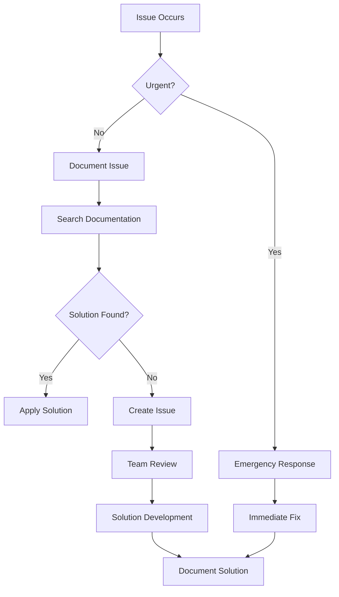

# 🐛 Troubleshooting Hub

Centralized troubleshooting resource for the Student Profiles PWA. Find solutions to common issues, setup problems, and development challenges.

## 🎯 Quick Problem Resolution

### **Common Issues**
- **[Setup Problems](./common-issues.md)** - Frequently encountered issues *(Coming Soon)*
- **[Development Issues](./development-issues.md)** - Development-specific problems *(Coming Soon)*
- **[Production Issues](./production-issues.md)** - Production deployment issues *(Coming Soon)*

### **Current Documentation**
- **[🔓 Login Bypass Issues](login-bypass-troubleshooting.md)** - **Development authentication problems**
- **[📋 Dev User Setup](dev-user-setup.md)** - Complete development environment setup
- **[🐞 Bug Reports](bugs.md)** - Known issues and bug tracking
- **[🔍 Frontend Issues](frontend-common-issues.md)** - Frontend-specific problems
- **[🌐 MIME Types](frontend-mime-types.md)** - Web server configuration issues
- **[📊 Test Issues](test-issues-comprehensive.md)** - Testing-related problems

---

## 🚨 Emergency Resources

### **Application Down?**
1. **Check Health**: Visit [http://127.0.0.1:8000/api/health](http://127.0.0.1:8000/api/health)
2. **Restart Services**: See [Development Issues](./development-issues.md#service-restart)
3. **Check Logs**: Review application and server logs
4. **Database Status**: Verify database connectivity

### **Can't Access Application?**
1. **Port Check**: Ensure ports 3002 (frontend) and 8000 (backend) are available
2. **Firewall**: Check firewall settings and port access
3. **Service Status**: Verify both frontend and backend services are running
4. **Network**: Test local network connectivity

---

## 📋 Issue Categories

### **🔧 Setup & Installation**
| Issue | Description | Solution |
|-------|-------------|----------|
| **Port Conflicts** | Port already in use | [Port Configuration](./common-issues.md#port-conflicts) |
| **Permission Errors** | File access issues | [Permissions Guide](./common-issues.md#permissions) |
| **Dependency Issues** | Missing packages | [Dependencies](./common-issues.md#dependencies) |
| **Environment Setup** | Configuration problems | [Environment Setup](dev-user-setup.md) |

### **💻 Development Issues**
| Issue | Description | Solution |
|-------|-------------|----------|
| **Build Failures** | Compilation errors | [Build Issues](./development-issues.md#build-failures) |
| **Hot Reload** | Development server issues | [Hot Reload](./development-issues.md#hot-reload) |
| **Debugging** | Can't debug application | [Debug Guide](./development-issues.md#debugging) |
| **Testing** | Test failures | [Test Issues](test-issues-comprehensive.md) |

### **🔐 Authentication Issues**
| Issue | Description | Solution |
|-------|-------------|----------|
| **Bypass Login Problems** | Development authentication issues | **[Bypass Login Guide](login-bypass-troubleshooting.md)** |
| **JWT Token Issues** | Token expiration/validation | [Auth Issues](./development-issues.md#authentication) |
| **Session Management** | Login/logout problems | [Auth Issues](./development-issues.md#authentication) |
| **CORS Errors** | Cross-origin request failures | [CORS Issues](./development-issues.md#cors) |

### **🌐 Frontend Issues**
| Issue | Description | Solution |
|-------|-------------|----------|
| **Styling Problems** | CSS/SCSS issues | [Styling Issues](frontend-common-issues.md#styling) |
| **Component Errors** | Component failures | [Component Issues](frontend-common-issues.md#components) |
| **MIME Types** | File serving issues | [MIME Types](frontend-mime-types.md) |
| **PWA Features** | Service worker problems | [PWA Issues](frontend-common-issues.md#pwa) |

### **🔌 Backend Issues**
| Issue | Description | Solution |
|-------|-------------|----------|
| **API Errors** | Endpoint failures | [API Issues](./development-issues.md#api-errors) |
| **Database** | Connection problems | [Database Issues](./development-issues.md#database) |
| **Authentication** | JWT/login problems | [Auth Issues](./development-issues.md#authentication) |
| **Performance** | Slow responses | [Performance](./development-issues.md#performance) |

---

## 🔍 Diagnostic Tools

### **Health Check Commands**
```bash
# API Health Check
curl http://127.0.0.1:8000/api/health

# Frontend Status
curl http://127.0.0.1:3002

# Database Check
# Check backend logs for database connection status
```

### **Log Locations**
- **Backend Logs**: `backend/app.log` or console output
- **Frontend Logs**: Browser developer tools console
- **Database Logs**: SQLite file or database server logs
- **System Logs**: `/var/log/system.log` (Linux/Mac)

### **Debug Mode**
Enable debug mode for detailed logging:
```bash
# Backend Debug
DEBUG=true python -m backend.main

# Frontend Debug
npm run dev  # Check browser console
```

---

## 📞 Getting Help

### **Self-Service Resources**
1. **🔍 Search**: Use Ctrl+F to search this page for keywords
2. **📋 Checklists**: Follow step-by-step troubleshooting guides
3. **🐞 Known Issues**: Review documented bugs and workarounds
4. **💬 Community**: Ask questions in project discussions

### **Escalation Path**
1. **Self-Service**: Try the solutions in this documentation
2. **Search Issues**: Check existing GitHub issues
3. **Create Issue**: File a new bug report or feature request
4. **Contact Team**: Reach out to the development team

### **Emergency Contacts**
- **Critical Production Issues**: Immediate team notification
- **Security Issues**: Security team contact
- **Data Loss**: Database administrator contact

---

## 🛠️ Prevention & Best Practices

### **Proactive Monitoring**
- Regular health checks
- Log monitoring and alerting
- Performance baseline tracking
- Backup verification

### **Development Practices**
- Code reviews for error handling
- Comprehensive testing
- Documentation updates
- Security best practices

### **Maintenance Schedule**
- **Daily**: Health checks and log review
- **Weekly**: Dependency updates and security patches
- **Monthly**: Performance review and optimization
- **Quarterly**: Architecture review and planning

---

## 📚 Related Documentation

- **[💻 Development Guide](../../development/guide.md)** - Development best practices
- **[🔧 Dev Setup](dev-user-setup.md)** - Complete setup instructions
- **[🧪 Testing Guide](../../testing/strategies.md)** - Testing methodologies
- **[🚀 Deployment Guide](../../deployment/)** - Deployment troubleshooting

---

## 🔄 Issue Resolution Workflow



---

*This troubleshooting hub is continuously updated with new issues and solutions. Check back regularly for the latest problem-solving resources.*

**Last Updated:** October 2025